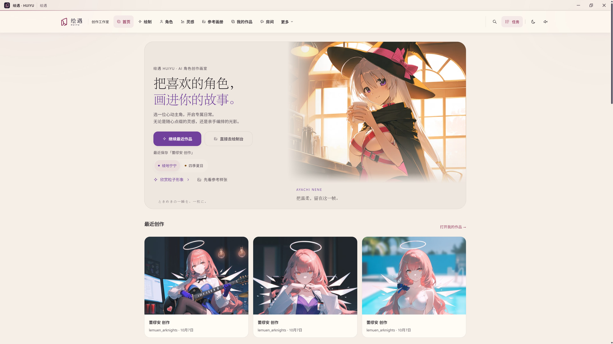
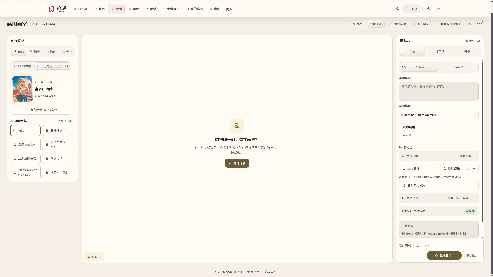
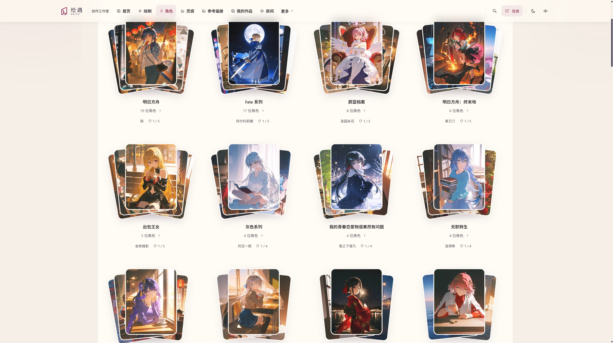
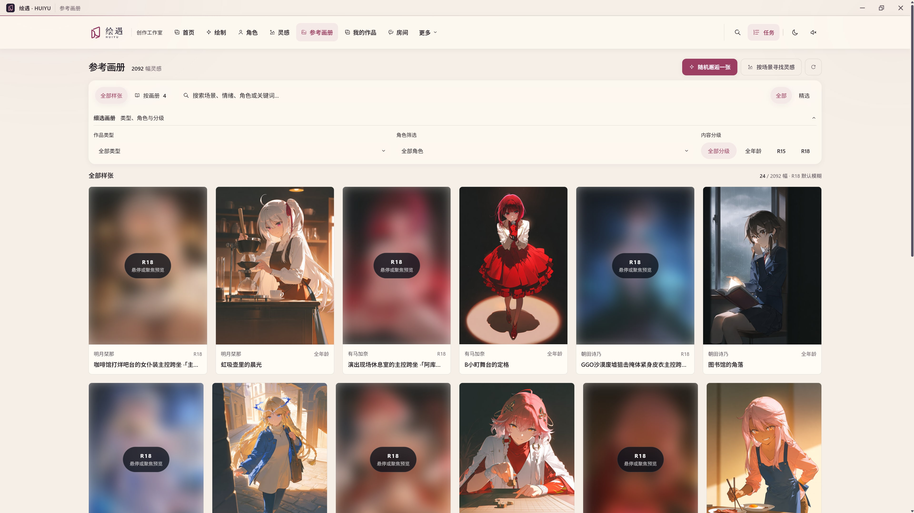
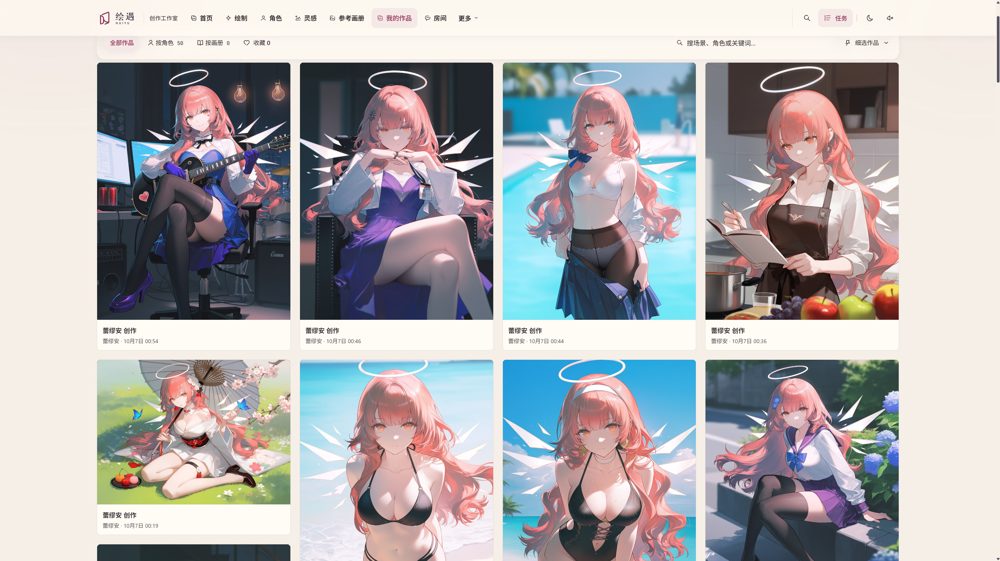
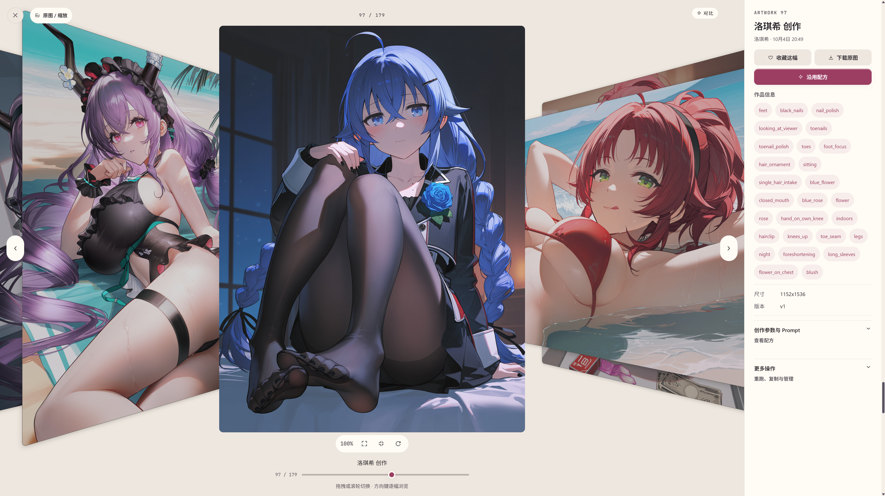

<p align="center"><picture><source media="(prefers-color-scheme: dark)" srcset="assets/logo.svg"></picture></p>

<h1 align="center">Bring your favorite characters into your story.</h1>

<p align="center">A local AI character studio for drawing, inspiration, artwork collections and desktop companionship.</p>

<p align="center"><a href="https://github.com/starplatium1129-stack/huiyu/releases/latest">Download for Windows</a> · <a href="docs/INDEX.md#发行说明">Documentation and release notes</a> · <a href="README_zh.md">中文说明</a></p>

Start with a character and a scene. Choose an outfit, camera and lighting, turn the moment into a CG, then keep the finished image and its recipe in your own artwork collection. Draw directly or browse the reference album for your next idea.

[](docs/images/software-preview/home.jpg)

##  From a moment to an image

Choose your character and materials on the left, view the canvas in the center, and adjust generation settings on the right. Scene mode helps shape an idea; expert mode exposes models, artist styles, prompts and sampling settings. Import references, interrogate images or edit an outfit when needed.

[](docs/images/software-preview/drawing-studio.jpg)

##  Characters, inspiration and your artwork

<table>
  <tr>
    <td width="50%"><strong>Character library</strong><br>Browse by series, then choose an outfit and scene.<a href="docs/images/software-preview/character-library.jpg"></a></td>
    <td width="50%"><strong>Reference album</strong><br>Find inspiration by character, scene and rating. Protected images retain blurred previews.<a href="docs/images/software-preview/reference-album.jpg"></a></td>
  </tr>
  <tr>
    <td width="50%"><strong>My artwork</strong><br>Organize images by character or album and save your favorites.<a href="docs/images/software-preview/my-works.jpg"></a></td>
    <td width="50%"><strong>Artwork viewer</strong><br>Browse large images, inspect generation details and reuse a recipe.<a href="docs/images/software-preview/artwork-viewer.jpg"></a></td>
  </tr>
</table>

Screenshots by the author. Click an image to view it full size.

##  Creative tools

| Feature | Current support |
| --- | --- |
| Drawing | Anima, Krea 2, Qwen and MOSS. Prompts follow the selected engine, and native drawing can connect to another HUIYU instance |
| Anima checkpoints | MiaoMiao Harem 1.6 by default, with Base, Aesthetic, Yume, MiaoMiao 1.2 and MiaoMiao 2.9B Beta 1.1 available |
| Character LoRAs | HUIYU author's Ayachi Nene and Shiki Natsume Anima v21; an Endfield collection with model-specific character bindings |
| Video studio | Shot lists, reference images and local Wan 2.2 TI2V 5B / MiniMax H3 paths |
| Model preparation | Choose the AI directory, models and runtimes in the control room; download and verification begin on explicit preparation |
| Artwork and recipes | Collections, search, favorites, recipe reuse, scene and blueprint editing |

New SD / WAI generation is retired; old artwork and task queries remain available. See the [model and environment guide](docs/guides/setup-and-models.md) for details on weights, hardware and setup.

##  Character room and desktop companion

A separate character room provides text chat, Live2D display and voice playback; a desktop companion can stay nearby. Connect a compatible API or existing Ollama, or prepare local llama.cpp and GGUF models. Voice, translation and lip sync require their own services and character resources. The control room manages connections and model resource release.

##  Install and start creating

1. Use the **full installer** for a first installation or repair. An existing installation can use the upgrade package when provided. [Windows downloads](https://github.com/starplatium1129-stack/huiyu/releases/latest)
2. Import the resources you need using the [offline resource guide](docs/guides/offline-resources.md). Resource packs are distributed separately; a program upgrade does not require downloading existing resources again.
3. Open the control room, choose the data and AI directories, and prepare models or connect existing services.
4. Pick a character and scene in the drawing studio. Save the finished image to My artwork.

**Packaged installations require neither Node.js nor Rust.** Local resources and artwork can be browsed offline. AI generation needs the matching models and runtimes; downloads and remote APIs require a connection. Model weights are not bundled with the program installer.

##  Run from source

Source builds on Windows require Node.js ≥22.18, npm and the Rust MSVC toolchain.

```powershell
git clone https://github.com/starplatium1129-stack/huiyu.git
cd huiyu
npm ci
npm run build
npm run start:run
```

See [startup and troubleshooting](STARTUP.md), [desktop deployment](docs/desktop-deployment.md) and the [workflow guide](docs/workflow.md).

## Architecture

| Directory | Responsibility |
| --- | --- |
| `src/` | Vue studio, prompt compilation and platform adapters. The web workspace uses IndexedDB |
| `desktop-tauri/` | Desktop windows, tray, native Live2D and gateway startup |
| `runtime-rs/` | Rust gateway, persistent tasks, SQLite workspace and service connections |
| `types/`, `tools/`, `scripts/` | Shared contracts, model workers, build and maintenance tools |

The runtime's `content/catalog.sqlite` is the working authority for characters, outfits, scenes and blueprints. `data/catalog/` contains explicitly exported project snapshots. Models and personal artwork live in the selected local directories. See the [engineering contracts](docs/engineering-contracts.md) and [documentation index](docs/INDEX.md) for detailed boundaries and storage designs.

## Project and licensing

HUIYU is a personal, non-commercial hobby project, occasionally shared with friends. HUIYU's original code remains under the [MIT license](LICENSE). The Rust runtime links [RustXNG](https://github.com/sahenjp/RustXNG/tree/08338038491d57adcfa4990ddf3d8925af292f4e), so the combined runtime is subject to [AGPL-3.0-or-later](assets/licenses/rustxng-AGPL-3.0.txt); releases must provide the corresponding source and retain its [notice](assets/licenses/rustxng-NOTICE.txt). Models, characters, Live2D assets, images and other resources retain their own licenses. This project is not affiliated with the original anime or game rights holders.

[Project status](docs/project-status.md) · [Roadmap](docs/roadmap.md) · [Documentation](docs/INDEX.md) · [Report an issue](https://github.com/starplatium1129-stack/huiyu/issues)
