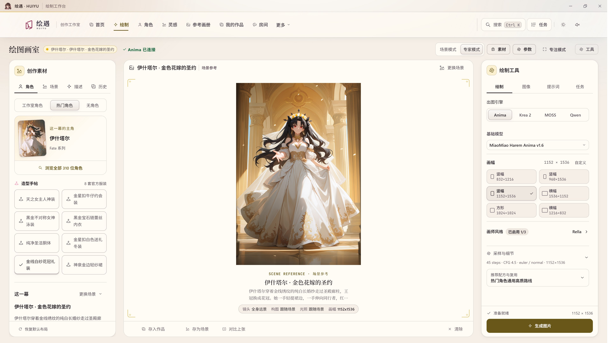
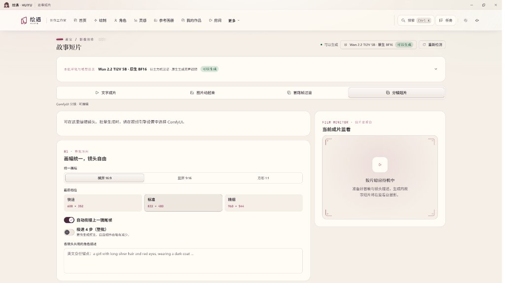
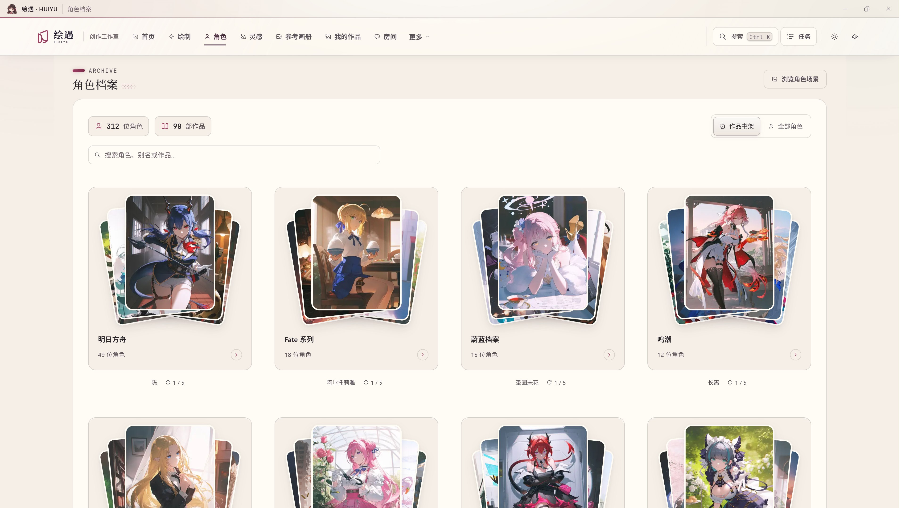
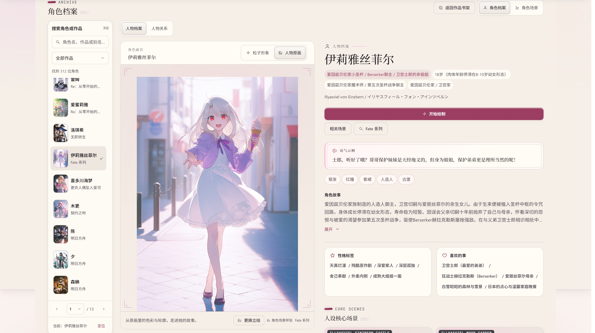
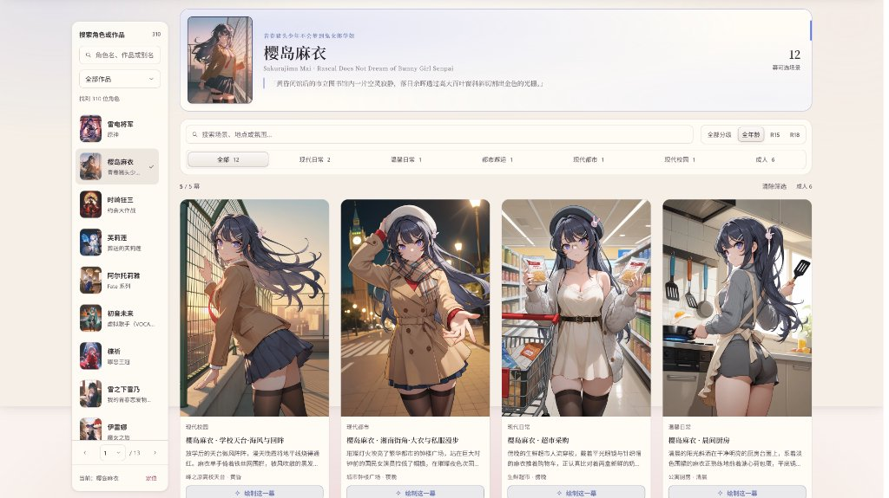
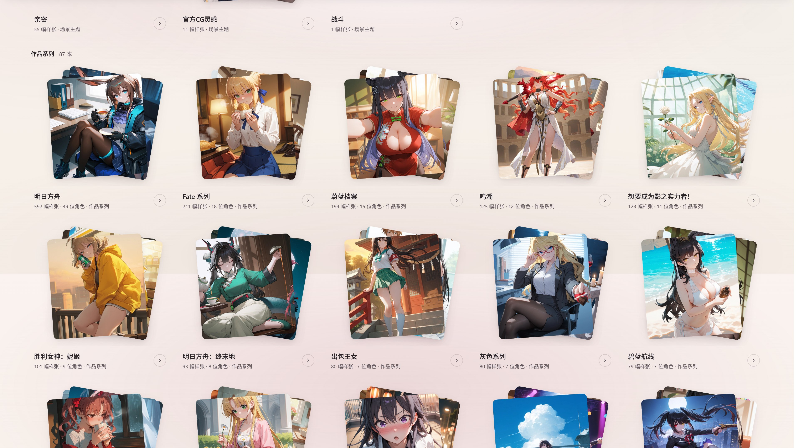
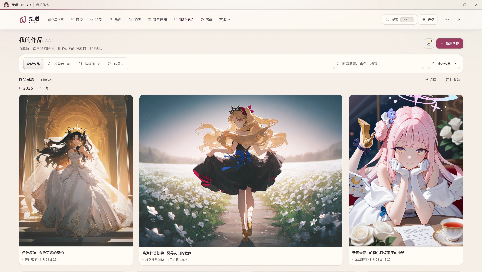
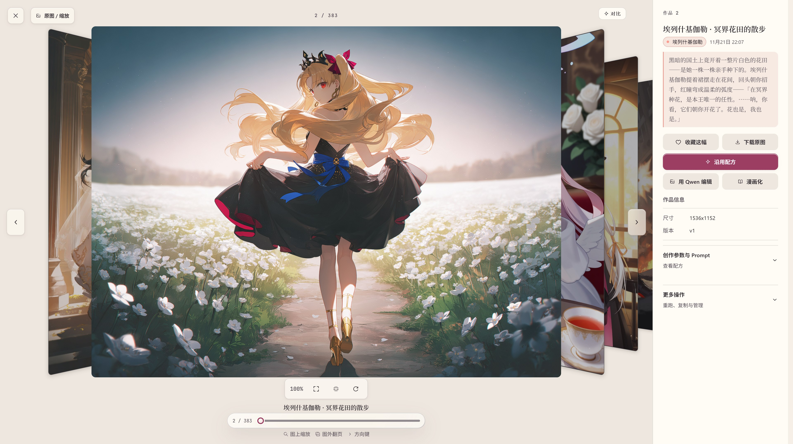
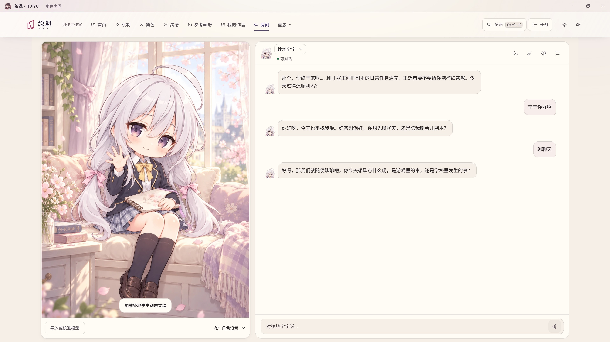
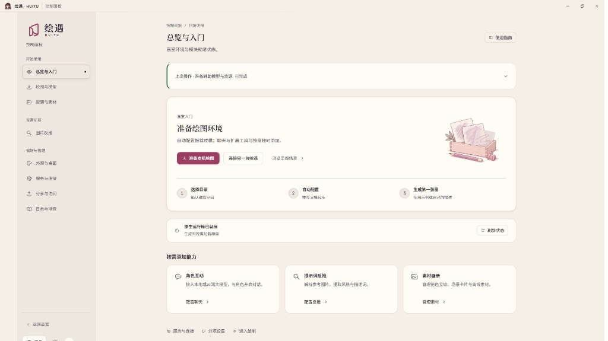

<p align="center"><picture><source media="(prefers-color-scheme: dark)" srcset="assets/logo.svg"></picture></p>

<h1 align="center">Bring your favorite characters into your story.</h1>

<p align="center">A local AI character studio for drawing, short videos, inspiration albums, artwork collections and desktop companionship.</p>

<p align="center"><a href="https://github.com/starplatium1129-stack/huiyu/releases/latest">Download for Windows</a> · <a href="docs/INDEX.md#发行说明">Documentation and release notes</a> · <a href="README_zh.md">中文说明</a></p>

Start with a character and a scene. Choose an outfit, camera and lighting, turn the moment into a CG or short video, and keep finished pieces alongside their generation recipes in your own collection.

##  Drawing Studio & Video Workbench

Pick characters, outfits and scenes on the left, focus on the canvas in the center, and tune generation settings on the right. Scene mode shapes ideas quickly, while expert mode exposes base checkpoints, artist styles, prompt compilation and masked outfit edits.

[](docs/images/software-preview/drawing-studio.jpg)

### Story Video Studio

Create **text-to-video**, **image-to-video**, **first/last-frame transitions** and **multi-shot storyboards** with unified aspect ratios, automatic shot chaining and an integrated film monitor.

[](docs/images/software-preview/video-studio.jpg)

##  Characters, Inspiration & Artwork Gallery

Move seamlessly from browsing series bookshelves and scene inspiration to organizing finished works and inspecting full-resolution details:

<table>
  <tr>
    <td width="50%"><strong>Series bookshelf</strong><br>Browse the character library grouped by game or series.<br><a href="docs/images/software-preview/character-library.jpg"></a></td>
    <td width="50%"><strong>Character profile</strong><br>Read character stories, view portraits and start drawing directly.<br><a href="docs/images/software-preview/character-profile.jpg"></a></td>
  </tr>
  <tr>
    <td width="50%"><strong>Character inspiration</strong><br>Filter character scenes by theme or rating and start any moment in one click.<br><a href="docs/images/software-preview/character-inspiration.jpg"></a></td>
    <td width="50%"><strong>Reference album</strong><br>Explore samples by character, theme or series (protected ratings blurred by default).<br><a href="docs/images/software-preview/reference-album.jpg"></a></td>
  </tr>
  <tr>
    <td width="50%"><strong>My artwork</strong><br>Organize creations by character or album with search, filters and favorites.<br><a href="docs/images/software-preview/my-works.jpg"></a></td>
    <td width="50%"><strong>3D artwork viewer</strong><br>Flip through your gallery in 3D, zoom into pixels and reuse saved recipes.<br><a href="docs/images/software-preview/artwork-viewer.jpg"></a></td>
  </tr>
</table>

##  Character Room & Desktop Companion

A dedicated character room pairs text chat with Live2D rendering and voice playback, while a transparent desktop companion stays nearby with screen reading and co-watching. Connect compatible APIs, existing Ollama, managed local llama.cpp (GGUF), or [remote Muse & QQ/WeChat channels](docs/guides/remote-and-muse.md).

[](docs/images/software-preview/character-room.jpg)

##  Creative Tools & Engines

| Area | Current support |
| --- | --- |
| Drawing engines | Anima, Krea 2, Qwen 2.1 and MOSS (engine-specific prompt compilation, remote HUIYU linking and friend guest play) |
| Anima checkpoints | MiaoMiao Harem 1.6 by default; supports Base 1.0, Aesthetic 1.1, Yume 1.0, MiaoMiao 1.2 and 2.9B |
| Character LoRAs | Author-trained Ayachi Nene & Shiki Natsume Anima v21, plus the Endfield character collection |
| Video studio | Wan 2.2 (5B/14B), MiniMax H3, HunyuanVideo 1.5, LTX-2.3/2.5, Kandinsky 6, Wan-Animate-2 and LongCat |
| Utilities & post | Local PixAI interrogation, MangaScreen halftones/lineart extraction and Remacri / UltraSharp upscaling |

> New SD / WAI generation is retired; historical artwork and task lookup remain intact. See the [model & environment guide](docs/guides/setup-and-models.md) and [independent inference guide](docs/guides/independent-inference.md) for weights and hardware requirements.

##  Control Panel & Getting Started

The control panel brings guided setup, native runtime checks, model downloads and optional modules (chat, image interrogation and offline resources) together in one view:

[](docs/images/software-preview/control-panel.jpg)

1. **Install**: Use the **full installer** for initial setup or repair, or the upgrade package for existing installations ([Windows releases](https://github.com/starplatium1129-stack/huiyu/releases/latest)).
2. **Import resources**: Follow the [offline resource guide](docs/guides/offline-resources.md) to import asset packs once—program upgrades preserve existing packs.
3. **Prepare environment**: Open the control panel, set your data and AI directories, download/verify models or link another HUIYU / ComfyUI host.
4. **Start creating**: Pick a character and scene in the drawing studio or inspiration library and save finished work to My artwork.

> **Packaged installations require neither Node.js nor Rust.** Browsing collections and offline resources works offline; model weights are not bundled in the program installer. *Screenshots by the author; click any image for full size.*

##  Run from Source & Architecture

Source builds on Windows require Node.js ≥22.18, npm and the Rust MSVC toolchain:

```powershell
git clone https://github.com/starplatium1129-stack/huiyu.git
cd huiyu
npm ci
npm run build
npm run start:run
```

| Directory | Responsibility |
| --- | --- |
| `src/` | Vue studio, prompt compilation and platform adapters (web mode uses IndexedDB) |
| `desktop-tauri/` | Tauri 2 desktop host, tray, native Live2D and modern installer |
| `runtime-rs/` | Rust gateway, durable task runtime, SQLite workspace and model/channel bridges |
| `types/`, `tools/`, `scripts/` | Shared contracts, Python inference workers, build and maintenance tools |

The runtime's `content/catalog.sqlite` serves as the working authority for characters, outfits, scenes and blueprints, while `data/catalog/` stores explicitly exported snapshots. See [startup & troubleshooting](STARTUP.md), [desktop deployment](docs/desktop-deployment.md), [engineering contracts](docs/engineering-contracts.md) and [workflow guide](docs/workflow.md).

## Project & Licensing

HUIYU is a personal, non-commercial hobby project occasionally shared with friends. Original HUIYU code remains under the [MIT license](LICENSE). The Rust runtime links [RustXNG](https://github.com/sahenjp/RustXNG/tree/08338038491d57adcfa4990ddf3d8925af292f4e), making the combined runtime subject to [AGPL-3.0-or-later](assets/licenses/rustxng-AGPL-3.0.txt) (releases must provide corresponding source and retain its [notice](assets/licenses/rustxng-NOTICE.txt)). Models, characters, Live2D assets and images retain their respective licenses; this project is not affiliated with any original anime or game rights holders.

[Project status](docs/project-status.md) · [Roadmap](docs/roadmap.md) · [Documentation](docs/INDEX.md) · [Report an issue](https://github.com/starplatium1129-stack/huiyu/issues)
