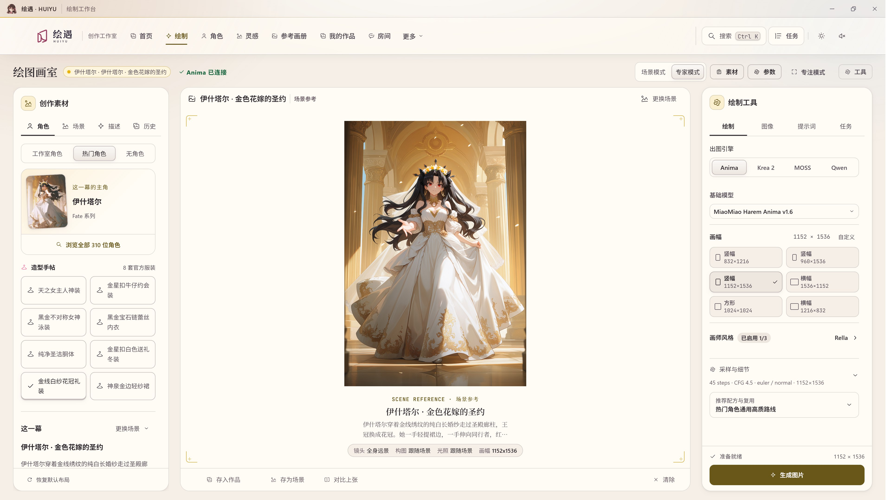
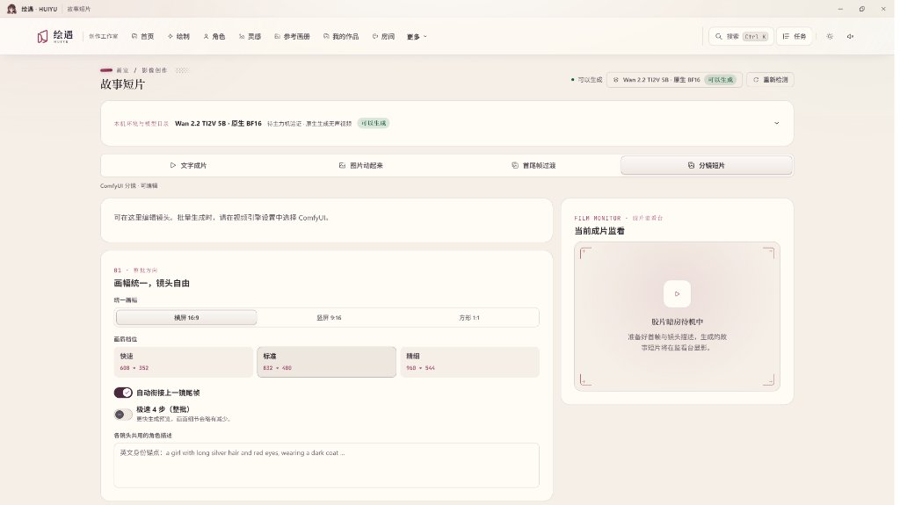
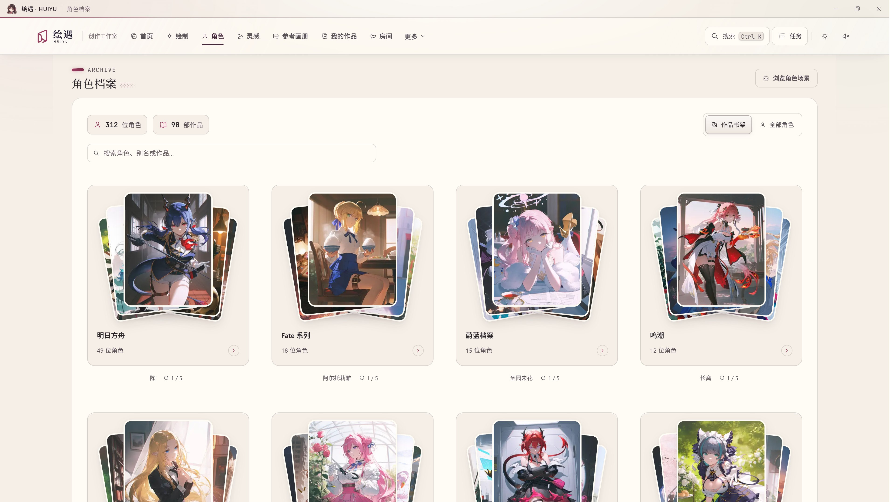
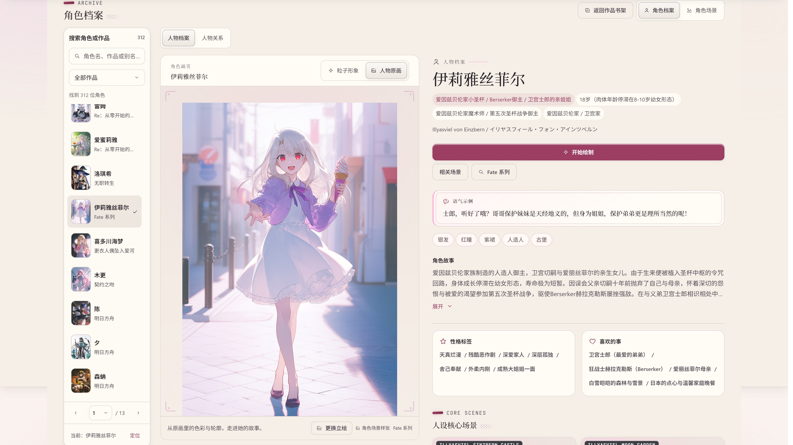
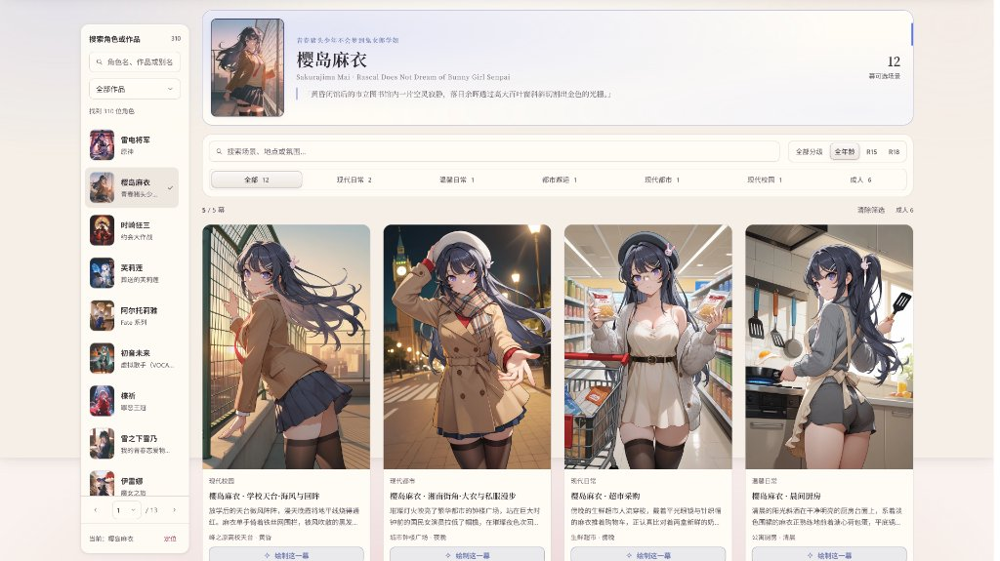
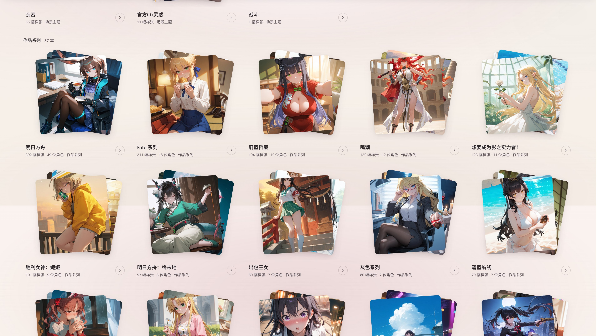
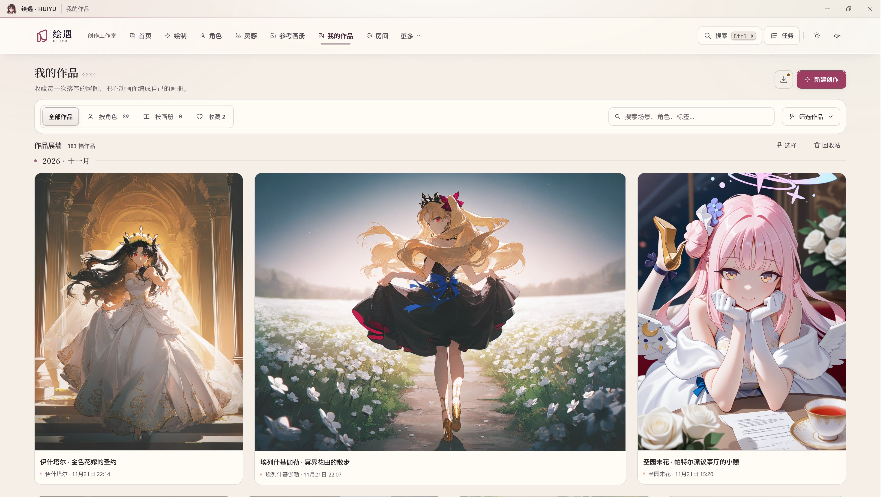
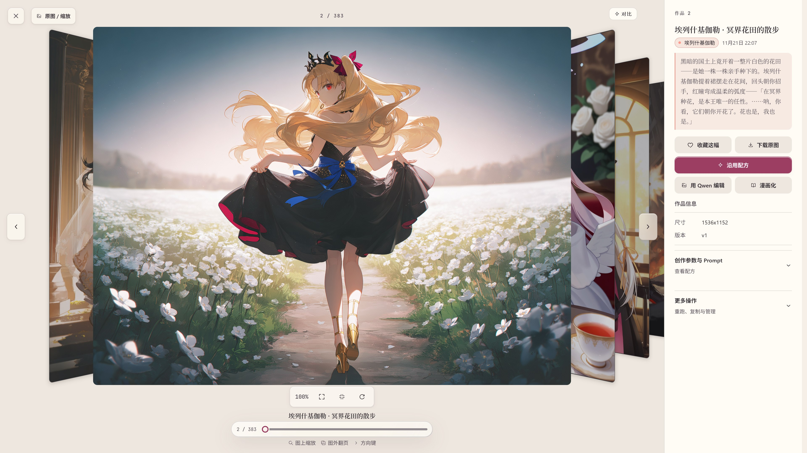
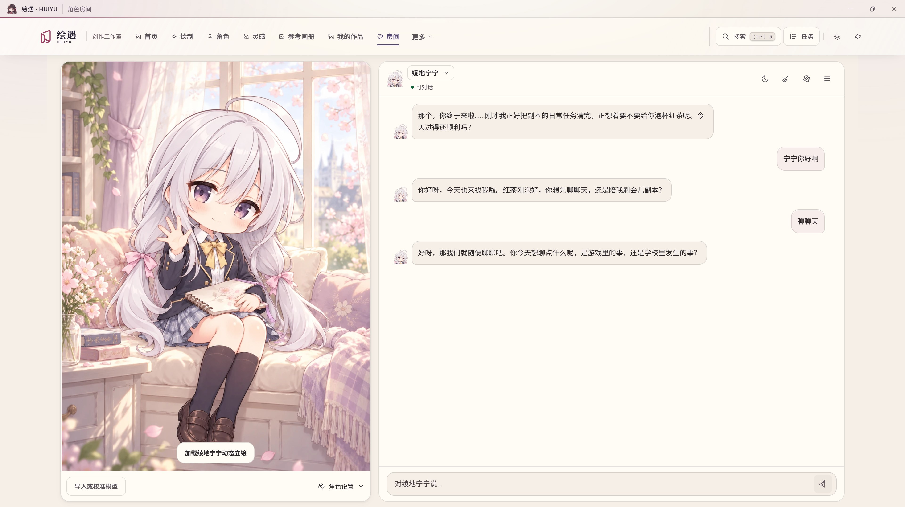
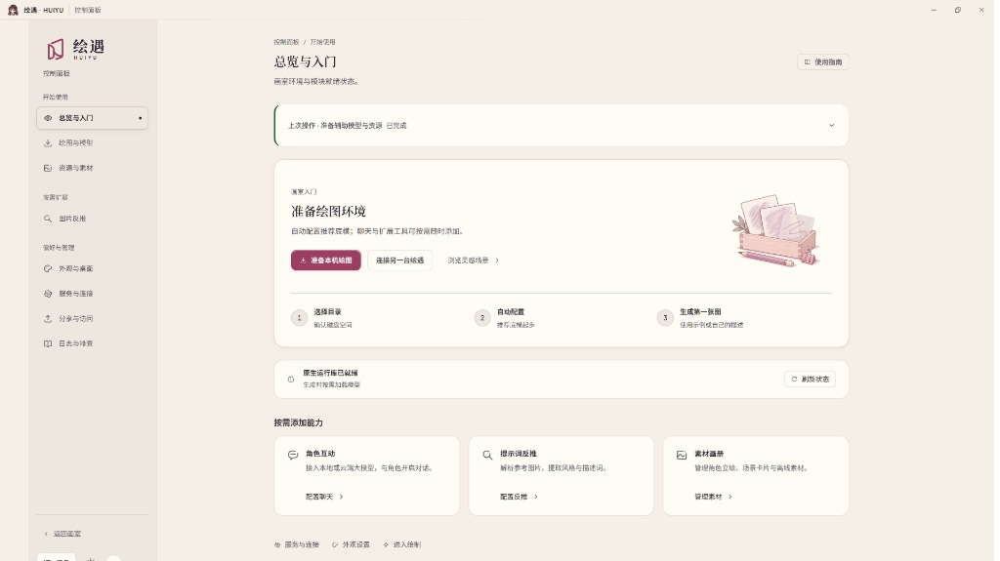

<p align="center"><picture><source media="(prefers-color-scheme: dark)" srcset="assets/logo.svg"></picture></p>

<h1 align="center">把喜欢的角色，画进你的故事。</h1>

<p align="center">本地运行的 AI 角色创作工作室 · 绘图、短片、灵感画册、作品收藏与桌面陪伴</p>

<p align="center"><a href="https://github.com/starplatium1129-stack/huiyu/releases/latest">下载 Windows 桌面版</a> · <a href="docs/INDEX.md#发行说明">文档与更新说明</a> · <a href="README.md">English</a></p>

从角色与场景出发，挑选衣装、镜头和光影，把脑海中的那一幕整理成 CG 或连续短片，并将成片与生成配方留在私人作品册里。

##  绘图画室与故事短片

左侧挑选角色、服装与场景，中间专注查看画布，右侧调配模型与生成参数；场景模式快速整理灵感，专家模式开放底模、画师风格、提示词编译与局部换装。

[](docs/images/software-preview/drawing-studio.jpg)

### 故事短片（影像创作）

支持 **文字成片**、**图片动起来**、**首尾帧过渡** 与 **分镜短片**，可统一画幅并自动衔接上一镜尾帧，在右侧监看台直接预览成片。

[](docs/images/software-preview/video-studio.jpg)

##  角色、灵感与作品画廊

从按系列找人、翻看档案与场景灵感，到归档作品与立体看大图，整个创作链路连贯统一：

<table>
  <tr>
    <td width="50%"><strong>作品书架</strong><br>按原作系列浏览角色库与主题入口。<br><a href="docs/images/software-preview/character-library.jpg"></a></td>
    <td width="50%"><strong>角色档案</strong><br>查看立绘与人物故事，从档案直接开画。<br><a href="docs/images/software-preview/character-profile.jpg"></a></td>
  </tr>
  <tr>
    <td width="50%"><strong>角色灵感</strong><br>按角色、分类与分级筛选可选场景，一键「绘制这一幕」。<br><a href="docs/images/software-preview/character-inspiration.jpg"></a></td>
    <td width="50%"><strong>参考画册</strong><br>按角色或系列翻阅参考样张，受保护分级默认模糊遮罩。<br><a href="docs/images/software-preview/reference-album.jpg"></a></td>
  </tr>
  <tr>
    <td width="50%"><strong>我的作品</strong><br>按角色与画册整理成片，支持搜索筛选与收藏。<br><a href="docs/images/software-preview/my-works.jpg"></a></td>
    <td width="50%"><strong>立体观画</strong><br>3D 翻阅作品集、原图细节缩放，并沿用原配方重绘。<br><a href="docs/images/software-preview/artwork-viewer.jpg"></a></td>
  </tr>
</table>

##  角色房间与桌面陪伴

独立角色房间提供文字对话、Live2D 动作展示与语音合成；桌面陪伴窗可常驻手边并支持看屏与陪看。聊天可连接兼容 API、已有 Ollama、受管本地 llama.cpp（GGUF），或接入 [远程 Muse 与 QQ/微信通道](docs/guides/remote-and-muse.md)。

[](docs/images/software-preview/character-room.jpg)

##  创作能力与支持引擎

| 模块 | 当前支持 |
| --- | --- |
| 图像引擎 | Anima、Krea 2、Qwen 2.1 与 MOSS（按引擎独立编译提示词，支持多机原生连接与好友试玩） |
| Anima 底模 | 默认 MiaoMiao Harem 1.6，支持 Base 1.0、Aesthetic 1.1、Yume 1.0、MiaoMiao 1.2 与 2.9B |
| 角色 LoRA | 内置适配作者训练的宁宁 / 夏目 Anima v21，以及终末地角色合集 |
| 短片工作台 | Wan 2.2（5B/14B）、MiniMax H3、HunyuanVideo 1.5、LTX-2.3/2.5、Kandinsky 6、Wan-Animate-2 与 LongCat |
| 辅助与后处理 | PixAI 本地图片反推、MangaScreen 漫画网点/线稿提取、Remacri / UltraSharp 超分放大 |

> SD / WAI 新生图已退役，保留历史任务与作品查看。完整权重与硬件要求见 [模型与环境指南](docs/guides/setup-and-models.md) 与 [独立推理指南](docs/guides/independent-inference.md)。

##  控制面板与上手流程

控制面板将入门引导、运行库检测、模型下载以及扩展能力（角色互动、提示词反推、素材画册）收拢在一处，新手也能按引导一步步完成环境配置：

[](docs/images/software-preview/control-panel.jpg)

1. **安装程序**：首次安装或修复使用 **full 完整安装包**，已有安装可用升级包（[Windows 下载](https://github.com/starplatium1129-stack/huiyu/releases/latest)）。
2. **导入素材**：按 [离线素材指南](docs/guides/offline-resources.md) 导入独立资源包，升级程序无需重复下载已有素材。
3. **准备环境**：打开控制面板选定数据与 AI 工作目录，一键下载并校验所需模型，或连接另一台绘遇 / ComfyUI。
4. **开始创作**：进入绘制工作台或角色灵感挑选一幕开画，成片自动留在「我的作品」。

> **成品无需安装 Node.js 或 Rust。** 浏览作品与离线素材可完全断网使用；模型权重不随程序安装包捆绑。*以上截图均由作者提供，点击图片可看原图。*

##  从源码运行与架构

在 Windows 从源码构建需要 Node.js ≥22.18、npm 与 Rust MSVC 工具链：

```powershell
git clone https://github.com/starplatium1129-stack/huiyu.git
cd huiyu
npm ci
npm run build
npm run start:run
```

| 目录 | 职责 |
| --- | --- |
| `src/` | Vue 工作台、提示词编译与平台适配（Web 模式使用 IndexedDB） |
| `desktop-tauri/` | Tauri 2 桌面宿主、托盘、原生 Live2D 与现代安装器 |
| `runtime-rs/` | Rust 产品网关、持久任务运行时、SQLite 工作区与模型/渠道连接 |
| `types/`、`tools/`、`scripts/` | 跨端契约、Python 推理工作进程、构建与维护工具 |

角色、服装、场景与蓝图以运行目录的 `content/catalog.sqlite` 为工作权威，`data/catalog/` 为显式导出的项目快照。详情参阅 [STARTUP](STARTUP.md)、[部署指南](docs/desktop-deployment.md)、[工程契约](docs/engineering-contracts.md) 与 [工作流](docs/workflow.md)。

Muse 和本机智能体可以通过同一套绘遇命令搜索素材、提交绘图和保存原图，也可以凭批次编号交接任务、查询报错。[智能体命令行用法](docs/desktop-deployment.md#多个助手共用一台出图机)

## 项目与许可

绘遇是面向个人创作、偶尔与朋友分享的非商业爱好项目。原创代码采用 [MIT 许可](LICENSE)；Rust 运行时链接了 [RustXNG](https://github.com/sahenjp/RustXNG/tree/08338038491d57adcfa4990ddf3d8925af292f4e)，组合后的运行时适用 [AGPL-3.0-or-later](assets/licenses/rustxng-AGPL-3.0.txt)（发行需附对应源码与 [许可声明](assets/licenses/rustxng-NOTICE.txt)）。模型、角色、Live2D 与图片等第三方资产保留各自原许可，项目与动漫/游戏原作及权利方无隶属关系。

[项目状态](docs/project-status.md) · [未来规划](docs/roadmap.md) · [文档索引](docs/INDEX.md) · [问题反馈](https://github.com/starplatium1129-stack/huiyu/issues)
